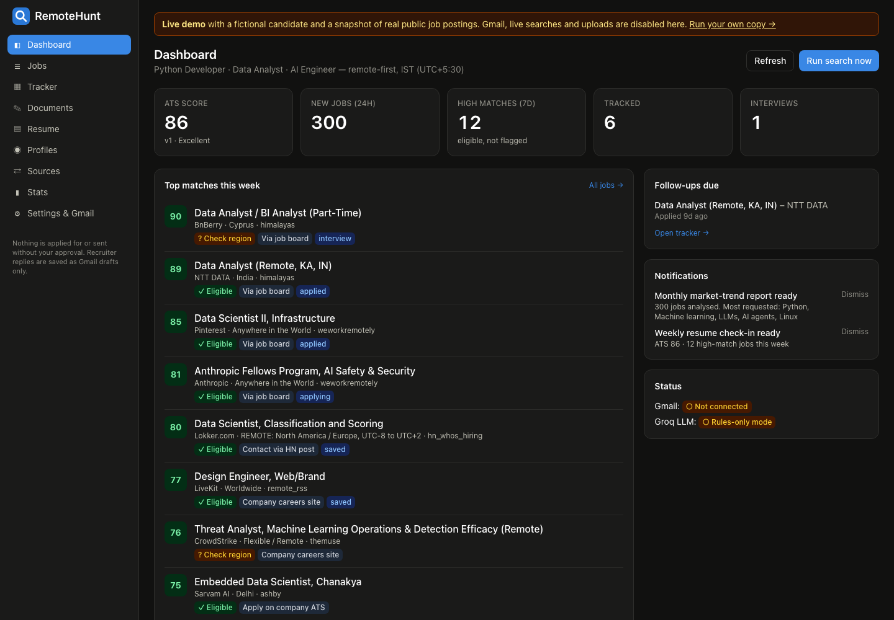
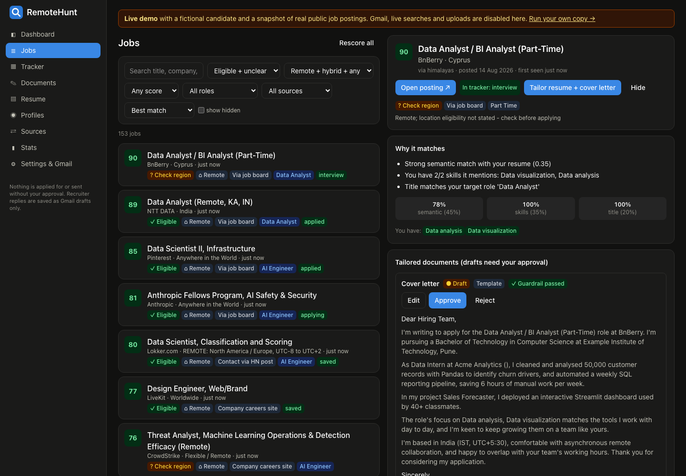
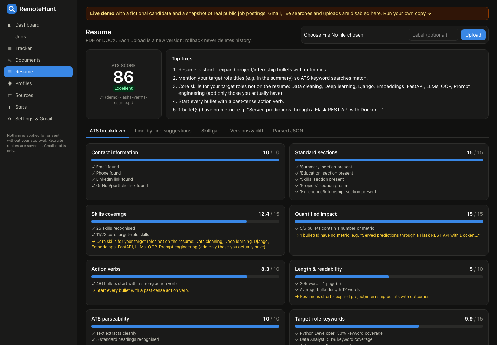
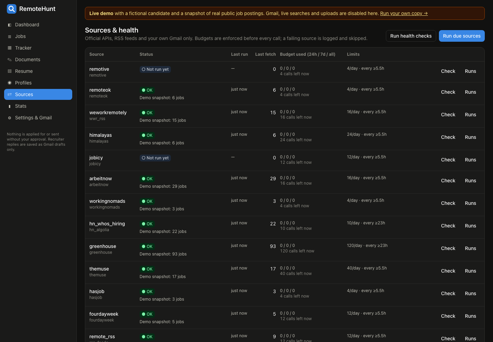
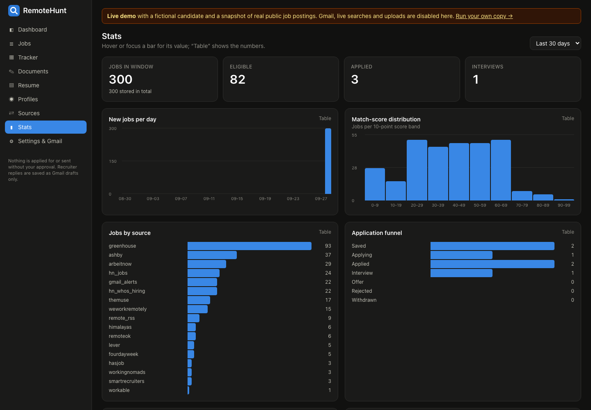
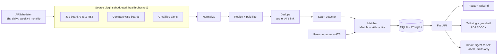

# RemoteHunt

[](https://github.com/parthchaitanya/remotehunt/actions/workflows/ci.yml)

**Live demo:** https://remotehunt-demo.onrender.com (fictional candidate, real public job postings; first load can take ~40 s while the free server wakes up)

A self-hosted job-search assistant that finds remote and hybrid **Python Developer, Data Analyst and AI Engineer** roles, scores them against your resume, and helps you apply well without ever applying, scraping or emailing anyone on your behalf.



## What it does

- **Resume intelligence:** parses PDF/DOCX into structured JSON and gives a rule-based ATS score (0–100) with a per-category breakdown. It adds line-by-line suggestions (rules plus an LLM, fact-checked by a guardrail), skill-gap analysis against live job-market demand, and version history with diff and rollback.
- **Job sources, 20+ plugins:** Remotive, Remote OK, We Work Remotely, Himalayas, Jobicy, Arbeitnow, Working Nomads, The Muse, Hasjob, 4dayweek, Real Work From Anywhere, Jobspresso, HN Who's Hiring and YC jobs, Adzuna and Jooble, plus Greenhouse, Lever, Ashby, Workable and SmartRecruiters boards for about 40 companies. It also parses job-alert emails from LinkedIn, Naukri, Indeed, Internshala and others through the Gmail API. Every plugin has call budgets, 429 back-off and a health check that never crashes a run.
- **Pipeline:** normalize → region and time-zone eligibility (tuned for IST) → paid-only filter → dedupe that prefers the direct ATS link → rule-based scam detector → match score with reasons and missing skills → apply-method tag. The match score combines sentence-transformers `all-MiniLM-L6-v2` similarity, skill overlap, title fit and a seniority penalty.
- **Tailored applications:** a resume and cover letter per high-match job, exported as PDF or DOCX. A **truthfulness guardrail** rejects any skill, number, title or credential that isn't on the real resume, and nothing is exported until you approve it.
- **Gmail assistant:** OAuth with Fernet-encrypted tokens, a daily digest at 08:00 IST (sent only to yourself), recruiter-email labels, reply **drafts** only, and 7-day follow-up reminders.
- **Profiles:** platform-ready text for LinkedIn, GitHub, Wellfound, Naukri and more, with a completion tracker and a cross-platform keyword-consistency check.
- **Scheduler and UI:** APScheduler runs search every 6h, the digest daily, a weekly resume check-in and a monthly market-trend report. The UI has a React dashboard, jobs list, Kanban tracker, documents, resume, profiles, source health and stats pages.

| Jobs, with the reason behind each score | Resume ATS breakdown |
|---|---|
|  |  |
| **Source health and API budgets** | **Stats** |
|  |  |

## Architecture



**Stack:** Python 3.12, FastAPI, SQLAlchemy 2, APScheduler, sentence-transformers, pdfplumber, python-docx, ReportLab, Groq (LLM), React 19, Vite, Tailwind 4, Docker Compose, Caddy, GitHub Actions.

## Run it

```bash
cp .env.example .env
docker compose up -d --build          # UI http://localhost:8080 · API http://localhost:8765
```

- [docs/SETUP.md](docs/SETUP.md): local install, Google OAuth, API keys.
- [docs/DEPLOY.md](docs/DEPLOY.md): private 24/7 deployment on Oracle Cloud Always Free.
- [docs/SHOWCASE.md](docs/SHOWCASE.md): this public demo on Render, and CI.
- Sample output: [resume report](docs/samples/resume_report.md), [digest email](docs/samples/digest_email.html).

## Engineering notes

- **Tests:** 60+ pytest tests cover the parser, matcher, scam detector, region rules, dedupe, guardrail, budgets, auth, demo mode and email parsing, and run in CI on every push.
- **Rules enforced in code, not just policy:** no scraping, no auto-apply, recruiter replies are drafts only, the digest is sent only to the owner's own address, rate limits are checked before each call, and a log-redaction filter keeps personal data out of logs.
- **Demo mode:** `DEMO_MODE=true` serves fictional data, disables Gmail, live searches and uploads, and uses a torch-free embedder so the demo runs in under 512 MB RAM.

```
backend/app/
  resume/     parser, ATS scorer, suggestions, skill gap, versions
  sources/    plugin base (budgets, health), boards, ATS boards, aggregators, Gmail alerts
  pipeline/   normalize, region, dedupe, scam, matcher, apply method, orchestration
  tailor/     guardrail, generator, PDF/DOCX export
  gmail/      OAuth client, alert parsers, classifier, sync/follow-ups, digest
  profiles/   platform text, checklist, consistency
  reports/    weekly check-in, monthly trends
  auth.py     single-user login for deployments · demo.py  public showcase mode
frontend/src/ React pages and components
config/       profile.yaml, sources.yaml, target_companies.yaml
```
